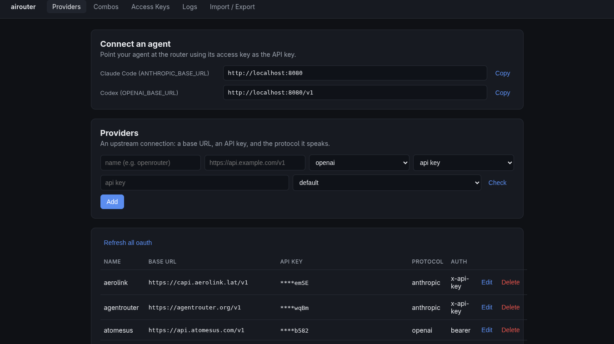

# airouter

A self-hosted AI inference router with an embedded web dashboard. Point OpenAI,
Anthropic, or compatible clients at one endpoint and route them to different
providers under your own model names.

- OpenAI Chat Completions, OpenAI Responses, and Anthropic Messages APIs
- Bidirectional format translation for unary and streaming requests
- Text, images, PDFs, reasoning, tool calls, and tool results
- Ordered failover or round-robin routing across providers
- API key and OAuth provider connections
- Single Go binary with embedded SQLite; no external services

## Quick start

Download a binary from [Releases](https://github.com/sabitm/airouter/releases), or
build from source with Go 1.26.1+:

```sh
go build -o airouter ./cmd/airouter
```

Generate a secret, keep it stable across restarts, and run:

```sh
export AIROUTER_SECRET="$(openssl rand -hex 32)"
./airouter
```

Open [http://localhost:31415/dashboard](http://localhost:31415/dashboard), then:

1. Add and check a provider.
2. Create a combo that maps a public model name to one or more provider models.
3. Generate an access key.
4. Use the airouter URL, access key, and combo name in your client.

The dashboard also shows ready-to-copy base URLs for Claude Code and Codex.



## Supported providers

Generic connections support OpenAI Chat Completions, OpenAI Responses, and
Anthropic-compatible APIs. The dashboard also includes guided connections for:

| Connection | Authentication |
|---|---|
| Grok (xAI) | OAuth |
| OpenAI Codex (ChatGPT) | OAuth |
| Cline / ClinePass | OAuth |
| Kiro (AWS CodeWhisperer) | API key or OAuth |
| Qoder | OAuth device flow |
| Antigravity (Google Cloud Code) | OAuth; unofficial |
| Cursor | OAuth or imported CLI/IDE token; unofficial |
| Claude Code | OAuth; unofficial CLI profile, not a supported proxy |
| OpenCode | zen tier: key `public`; go tier: opencode.ai API key |

Provider credentials and OAuth tokens are encrypted in SQLite using
`AIROUTER_SECRET`. OAuth tokens are refreshed automatically when supported.

### OpenCode notes

Select the Zen or Go tier in the dashboard. Zen uses the key `public`; Go
requires an opencode.ai API key. airouter selects the upstream API format and
endpoint for each model automatically. Custom and self-hosted URLs are used
unchanged.

A successful dashboard Check confirms model discovery, not inference access.
Free-model access depends on OpenCode's upstream restrictions and is not
guaranteed. Paid Zen models and OpenCode Go are the supported paths for
third-party clients.

## Client API

| Endpoint | Format |
|---|---|
| `POST /v1/chat/completions` | OpenAI Chat Completions |
| `POST /v1/responses` | OpenAI Responses |
| `POST /v1/messages` | Anthropic Messages |
| `POST /v1/images/generations` | OpenAI-compatible Images generation (Codex only) |
| `GET /v1/models` | Configured combos |

The same routes are available without `/v1`. Use a combo name as the request's
`model`. When at least one access key exists, authenticate with either:

```text
Authorization: Bearer sk-air-...
x-api-key: sk-air-...
```

Example:

```sh
curl http://localhost:31415/v1/chat/completions \
  -H "Authorization: Bearer sk-air-..." \
  -H "Content-Type: application/json" \
  -d '{"model":"default","messages":[{"role":"user","content":"hello"}]}'
```

When no access keys exist, proxy endpoints run in open mode.

Custom Chat Completions models that route to OpenAI Codex should set
`sendSessionAffinityHeaders=true` and `sessionAffinityFormat=openai`. Those
headers are the authoritative conversation identity for Codex caching. When no
identity arrives, Airouter derives a fallback from an available initial
conversation prefix. If no safe bounded anchor is available, Airouter uses a
request-local key.

## Codex image generation

Use an existing Codex provider and create a combo whose upstream model is an
image model. No separate credential is needed. For example, configure a combo
named `image` with the upstream model `gpt-image-2.6-flare`:

```sh
curl http://localhost:31415/v1/images/generations \
  -H "Authorization: Bearer sk-air-..." \
  -H "Content-Type: application/json" \
  -d '{"model":"image","prompt":"Draw a cabin beside a lake"}'
```

The response contains one PNG image in `data[0].b64_json`. Decode that base64
string to save the image. The route is also available as `/images/generations`.
The configured upstream model ID is sent unchanged. Model availability depends
on the provider and account. The linked references list `gpt-image-2`,
`gpt-image-2.6-flare`, and `gpt-image-2.6-sunburst`; this does not establish an
account entitlement or a bare `gpt-image-2.6` alias.

| Field | Supported values |
|---|---|
| `model` | Required combo name |
| `prompt` | Required nonempty string |
| `n` | `1` (default) |
| `size` | `auto` (default) |
| `quality` | `auto` (default), `low`, `medium`, `high` |
| `background` | `auto` (default), `opaque` |
| `output_format` | `png` (default) |
| `response_format` | `b64_json` (default) |
| `stream` | Omitted or `false` |
| `user` | Optional string, accepted locally but not sent upstream |

Unsupported fields and controls return HTTP 400 before an upstream send. This
version does not support edits, reference images, masks, fixed sizes, multiple
images, transparent backgrounds, alternate formats, compression, streaming, or
image-generation tools through `/v1/responses`. Accepted controls follow the
native request format; live behavior can still depend on the upstream.

Only enabled targets using the Codex protocol can serve this route. Incompatible
targets are skipped without a health penalty. Existing combo round-robin and
provider backoff rules still apply. Image failures can defer the same provider
for later chat requests. Failover before a response is sent can generate and
bill twice if an earlier upstream completed but its response was lost.

Image requests use the five-minute unary timeout and the existing 64 MiB request
and upstream-response limits. Returned base64 and its PNG signature are checked
before a successful response is sent. Reported token usage is preserved and is
not estimated from image bytes. HAR capture remains opt-in and truncates each
body at 1 MiB, so a captured image can be incomplete.

### Agent skill

The distributable [`image-generation` skill](skills/image-generation/SKILL.md)
uses this endpoint without adding tools to chat requests. It saves decoded PNGs
in the agent's workspace. The chat provider does not need image-generation
support. The image combo still requires an enabled Codex target.

Copy the complete `skills/image-generation/` directory into your harness's skill
location. Pi supports `.agents/skills/image-generation/` inside a project or
`~/.agents/skills/image-generation/` for the current user. Other harnesses may
use different locations. Reload skills or restart the harness after installing.
In Pi, invoke `/skill:image-generation` explicitly if automatic selection does
not load it. Installation does not change Airouter or install a runtime.

The skill checks for Python 3.10+ first, then Node.js 22+. Both bundled helpers
use built-in libraries only and accept the same arguments. If neither runtime
is present, install one separately. Do not switch runtimes and resend after a
generation failure because the first request may already have incurred charges.

From this repository, generate one image with either command:

```sh
python3 skills/image-generation/scripts/generate_image.py --prompt "A cabin beside a lake, watercolor" --output images/cabin.png
node skills/image-generation/scripts/generate_image.mjs --prompt "A cabin beside a lake, watercolor" --output images/cabin-node.png
```

Use only one command for each requested image. On Windows, use `py -3` or
`python` instead of `python3` when that is the supported interpreter. Set
`AIROUTER_URL`, `AIROUTER_IMAGE_MODEL`, and optional `AIROUTER_API_KEY` in the
agent environment. The URL and combo default to `http://localhost:31415` and
`image`. `--url` and `--model` override those defaults. No key is sent in open
mode when `AIROUTER_API_KEY` is unset. Keep remote authenticated connections on
HTTPS. The helpers connect directly without environment proxies or redirects.

For batches, pass `--batch jobs.json` with a JSON array of `prompt`/`output`
objects. Jobs may override `quality` and `background`. Relative output paths
resolve from the process working directory. The queue runs serially, preserves
successful files, and reports each result as one JSON line without base64 data.
It never overwrites outputs or retries a failed job. See the skill for batch
examples, supported controls, limits, and timeout guidance.

## Routing

- A **provider** is an upstream URL, protocol, and credential. Optional tags
  (lowercase letters, digits, and internal hyphens) label providers for the
  dashboard. The Providers and Usage tabs can filter by one tag or Untagged.
  Usage **Load all** loads only providers that match the active filter.
- A **combo** is the model name clients use. Each target maps a provider to its
  real upstream model ID.
- An **access key** authenticates clients to airouter. Its full value is shown
  once; only its hash is stored.

`failover` tries targets in order. `roundrobin` rotates the first target and still
fails over if it cannot start a response. Repeatedly failing providers are
temporarily deprioritized.

Matching API formats pass through with only the model rewritten, preserving
provider-specific fields. Different formats are translated automatically,
including live streams.

Anthropic thinking signatures and redacted thinking blocks are preserved when
both the client format and the selected provider format are Anthropic Messages,
Claude Code, or OpenCode Messages. A request that already contains signed or
redacted thinking is rejected with HTTP 400 when no enabled combo target can
preserve that history. Other client formats receive only readable thinking text.
The proxy does not copy Anthropic signatures into OpenAI encrypted content and
does not return redacted data as text.

Claude Code uses a pinned CLI profile (version 2.1.303). A dashboard Check
calls `GET /models` only. A passing Check does not prove that Messages
requests will be accepted, and it does not send an inference request. The
profile does not include the Claude Agent SDK runtime, cloud gateway, remote
workers, or telemetry. A browser connect uses the official authorize and token
endpoints, but that login path is not a verified first-party login. Existing
connections keep their stored endpoints and are not expanded to newer scopes.

## Configuration

Flags override environment variables.

| Flag | Environment | Default | Purpose |
|---|---|---|---|
| `-listen` | `AIROUTER_LISTEN` | `:31415` | HTTP listen address |
| `-db` | `AIROUTER_DB` | `airouter.db` | SQLite database path |
| `-secret` | `AIROUTER_SECRET` | insecure development key | Credential encryption secret |
| `-debug` | `AIROUTER_DEBUG` | `0` | `1` for request diagnostics; `2` for metadata traces |
| `-har-file` | `AIROUTER_HAR_FILE` | unset | Always-on HAR capture and shutdown output path |
| `-disable-dashboard` | `AIROUTER_DISABLE_DASHBOARD` | `false` | Do not mount the web dashboard or `/static` assets |
| `-version` | — | `false` | Print the version and exit |

Debug logs never include request or response bodies. Capture full exchanges from
**Dashboard > Settings**, or use `-har-file`. HAR files include prompts,
responses, authorization headers, and provider credentials.

### OpenCode session diagnostics

With `-debug=2`, official OpenCode free-model requests log session and connection
metadata without adding requests or retries. Session identifiers are masked;
prompts, bodies, and credentials are not logged. Keep these logs private because
they can link requests within one server run.

## Security and data

- Always set and retain a strong `AIROUTER_SECRET`. Changing it makes existing
  encrypted credentials unreadable.
- The dashboard controls providers and exposes plaintext config exports. It has
  no built-in login; keep it on a trusted network or protect it with an
  authenticated reverse proxy. In production, prefer `-disable-dashboard` so
  the UI, `/static` assets, config import/export, and OAuth connect flows are
  not mounted.
- Config exports include provider API keys, OAuth tokens, and tags in plaintext.
  Access keys and request logs are not exported.
- HAR captures contain sensitive headers and bodies. Store and share them as
  secrets. `-disable-dashboard` does not disable `GET /debug/har`; that
  endpoint remains mounted and may serve captured prompts and credentials.

State is stored in one automatically migrated SQLite database using WAL mode.
Provider credentials are encrypted at rest; access keys are hashed.

## Development

```sh
templ generate   # after editing internal/web/*.templ
go test ./...
go vet ./...
```

Validate both skill helpers against local mock servers with Python 3.10+ and
Node.js 22+ installed:

```sh
PYTHONDONTWRITEBYTECODE=1 python3 skills/image-generation/tests/test_helpers.py
```

The suite reports when Node.js is unavailable and only the Python contract ran.
It does not call a live provider. Windows users can omit the environment prefix
and use their Python command.

[MIT License](LICENSE)
